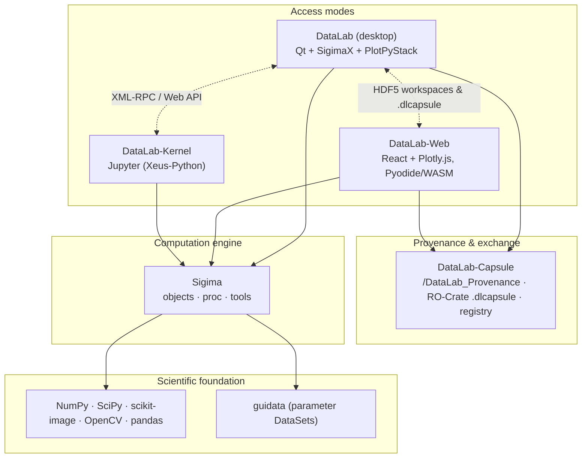

# The DataLab Platform — Complete Overview

> This document is the reference overview of the **DataLab Platform** ecosystem: what each component is, how they fit together, how they differ, and where the platform is heading. For a quick introduction, see the [organization profile](https://github.com/DataLab-Platform).

  

## Table of contents

- [What is the DataLab Platform?](#what-is-the-datalab-platform)
- [Terminology](#terminology)
- [History and milestones](#history-and-milestones)
- [Architecture](#architecture)
- [The products in detail](#the-products-in-detail)
  - [DataLab (desktop)](#datalab-desktop)
  - [Sigima (computation engine)](#sigima-computation-engine)
  - [SigimaX (Qt application framework)](#sigimax-qt-application-framework)
  - [DataLab-Web (browser-native)](#datalab-web-browser-native)
  - [DataLab-Kernel (Jupyter)](#datalab-kernel-jupyter)
  - [DataLab-Capsule (provenance and capsules)](#datalab-capsule-provenance-and-capsules)
  - [Plugins and scientific applications](#plugins-and-scientific-applications)
- [Interoperability](#interoperability)
- [DataLab vs DataLab-Web](#datalab-vs-datalab-web)
- [Technology stacks](#technology-stacks)
- [Quality and testing](#quality-and-testing)
- [Governance, licensing and funding](#governance-licensing-and-funding)
- [Roadmap](#roadmap)
- [Resources and links](#resources-and-links)

## What is the DataLab Platform?

The **DataLab Platform** is an open-source ecosystem for scientific and technical data processing, focused on **1D signals** (curves) and **2D images** (arrays). It serves both **research** (exploratory analysis, prototyping) and **industry** (test benches, quality control, non-destructive testing) with the same tools.

What started in 2023 as a single desktop application has grown into a family of complementary products sharing one scientific core:

- a **desktop application** (DataLab) with a rich Qt-based interactive GUI,
- a **browser-native edition** (DataLab-Web) running entirely client-side via WebAssembly — no install, no server, no upload,
- a **Jupyter kernel** (DataLab-Kernel) for notebook-driven workflows,
- a **headless computation engine** (Sigima) powering all of the above,
- a **reusable Qt application framework** (SigimaX) extracted from DataLab for building scientific desktop applications,
- an **open workspace provenance and capsule package** (DataLab-Capsule) for exchanging, comparing, and verifying analyses across editions,
- a **plugin catalog and official application plugins** extending both Desktop and Web with domain-specific workflows and instrument simulators.

The guiding principle: **one processing catalog, one object model, one workspace and provenance format — several access modes**. The same operation applied to the same imported data with compatible Sigima versions gives the same result in every edition — exactly, or within the comparison rule declared by the operation's replay qualification — and HDF5 workspaces and `.dlcapsule` archives flow freely between them. Editions may run different Sigima versions (DataLab-Web pins its own) and keep their own file importers, so equivalence is a verified property of each operation, not a blanket promise.

## Terminology

| Name | Meaning |
| --- | --- |
| **DataLab Platform** | The umbrella term for the whole ecosystem (all products below). |
| **DataLab** | The reference **desktop application** (Qt-based). The historical product. |
| **DataLab-Web** | The **browser-native** edition: the full platform running inside a browser tab. |
| **DataLab-Kernel** | A **Jupyter kernel** exposing DataLab workspaces to notebooks. |
| **Sigima** | The headless **computation engine** (signal and image processing) shared by all of the above. |
| **SigimaX** | The reusable **Qt application framework** (main window skeleton, configuration, plot docks, HDF5 workspace, scientific widgets) on which DataLab Desktop is built. |
| **DataLab-Capsule** | The **provenance and capsule** library, CLI, and optional registry for packaging, comparing, and verifying workspaces as open RO-Crate `.dlcapsule` archives. |
| **DataLab Plugin Catalog** | The curated **plugin catalog** ([datalab-platform.com/plugins](https://datalab-platform.com/plugins/)) serving official and community plugins for DataLab Desktop and DataLab-Web. |
| **PlotPyStack** | The Qt visualization foundation used by the desktop application ([guidata](https://github.com/PlotPyStack/guidata), [PythonQwt](https://github.com/PlotPyStack/PythonQwt), [PlotPy](https://github.com/PlotPyStack/PlotPy)) — a sibling organization maintained by the same team. |

## History and milestones

| Date | Milestone |
| --- | --- |
| 2023 | DataLab launched as an open-source desktop application for signal/image processing, built on the PlotPyStack (guidata + PlotPy). |
| 2024 | Talks at [SciPy 2024](https://www.youtube.com/watch?v=MKPUuV1LEqk), [PyData Paris 2024](https://www.youtube.com/watch?v=yn1bR-BVfn8), and Open Source Experience (OSXP 2024). |
| 2025 | **DCAR project** (DataLab Core Architecture Redesign, funded by [NLnet](https://nlnet.nl/) / NGI0 Commons Fund): extraction of all processing logic into the standalone, GUI-independent **Sigima** library. |
| 2025-10-28 | **Sigima v1.0.0** released on PyPI. |
| 2025-11 | **DataLab v1.0.0** released — complete rewrite using Sigima as its processing backend. DCAR completed. |
| 2025-12 | Talk at Open Source Experience (OSXP 2025) on automatic X-ray scene reconstruction with Python and DataLab. |
| 2026 | **DEW project** (DataLab Experimental Web Interface, funded by NLnet / NGI0 Commons Fund): browser-native reimplementation and reproducible workspace capsules. |
| 2026-06-26 | DEW Task 1 (feature-rich browser-native DataLab) fully delivered — [live demo](https://datalab-platform.com/web/) with off-thread runtime, on-disk storage, internationalization (EN/FR). |
| 2026-07 | DataLab desktop [packaged for NixOS](https://ngi.nixos.org/app/datalab) by the [Nix@NGI team](https://nixos.org/community/teams/ngi/) (NLnet partner) and published on the NGI Forge. Presentation at [EuroSciPy 2026](https://euroscipy.org/) (Kraków). |
| 2026-08 | **SigimaX** extracted as a standalone Qt application framework; **DataLab v1.3** released (History panel, built-in AI assistant, command palette, spectral peak tools). |
| 2026-10 | **DataLab-Capsule v0.1.0** and **DataLab v1.4** released: end-to-end workspace provenance (`/DataLab_Provenance`), open RO-Crate capsules (`.dlcapsule`) and optional registry across Desktop and Web, **Applications** catalog with live instrument simulators, [DataLab Plugin Catalog](https://datalab-platform.com/plugins/), and official Camera & Pulse characterization plugins. |

Full project reports and Architecture Decision Records are published on the [DataLab wiki](https://github.com/DataLab-Platform/DataLab/wiki).

## Architecture

The platform follows a strict layered design: the science lives in one place (Sigima), and each product is an access mode on top of it.

Key architectural facts:

- **Sigima is GUI-independent** (no Qt), organized in three layers: `sigima.objects` (data model: `SignalObj`, `ImageObj`, ROIs), `sigima.proc` (high-level computation functions on objects), `sigima.tools` (low-level NumPy algorithms).
- **SigimaX separates the generic Qt application skeleton** (main window, `OptionField` configuration, dockable plot widgets, HDF5 browser/workspace, scientific dialogs) from DataLab's domain-specific signal/image workflows.
- **Processing parameters are declarative** `guidata` DataSets: every edition auto-generates its parameter dialogs from the same schemas (Qt widgets on desktop, React forms on the web).
- **The processing catalog is shared, its exposure is per edition**: a function declared in Sigima with `@computation_function` carries its operation contract (identifier, version, inputs, parameters, replay qualification), discovered by introspection, so that an operation recorded in the provenance of one edition can be identified and replayed by another. Exposing it to users remains an integration step of each edition: the desktop registers it in its processors and menus (which also makes it available to remote control and to the kernel), while DataLab-Web derives its menus from the catalog, with per-feature overrides (titles, menu paths, icons).
- **Interoperability and provenance are contract-based**: the HDF5 workspace format, the `/DataLab_Provenance` ledger, the RO-Crate `.dlcapsule` format (`DataLab-Capsule`), the renderer-independent plot annotations, the object model, and the remote-control API surfaces are shared contracts between editions.

## The products in detail

### DataLab (desktop)

The reference application — richest feature set and fastest experience.

- **Repository**: [DataLab-Platform/DataLab](https://github.com/DataLab-Platform/DataLab) · **PyPI**: [`datalab-platform`](https://pypi.org/project/datalab-platform/) · **Docs**: [datalab-platform.com](https://datalab-platform.com/)
- **GUI**: Built on **SigimaX** and the **PlotPyStack** — full interactive PlotPy visualization tools (zoom, cross-sections, brightness/contrast adjustment with live histogram, portable annotations, ROI editing), welcome page, and VS Code-style command palette.
- **Processor pattern**: a registration layer maps Sigima functions to generic processing types (1→1, 1→0, 1→n, n→1, 2→1) with multi-selection semantics, X-array compatibility checks, auto-interpolation, and optional live processing previews.
- **History & provenance**: a **History** panel records, edits, and replays processing chains; a **Provenance** tab tracks how every object was obtained, checks data integrity, and recomputes steps to verify results without modifying the workspace; **Workspace capsules** (`.dlcapsule`) export, inspect, compare, and exchange verifiable workspaces.
- **Applications & plugin system**: extensible plugin architecture with hot-reload, wheel installation from file or from the [DataLab Plugin Catalog](https://datalab-platform.com/plugins/), `datalab-plugin` scaffolding CLI, and a top-level **Applications** catalog supporting declarative multi-input recipes, datasets, tools, and live instrument simulators.
- **Macro system & AI Assistant**: user-scriptable automation in Python through the proxy API, plus an optional built-in **AI Assistant** dock (compatible with any OpenAI endpoint or offline mock) that can inspect the workspace, run processings, and propose macros with explicit user confirmation.
- **Remote control**: XML-RPC API (`RemoteProxy`) plus a FastAPI-based **Web API** (HTTP/JSON, token-authenticated) used notably by DataLab-Kernel.
- **Persistence**: HDF5 workspaces on disk with stable `#UUID8` object references; broad file-format support for signals and images (CSV, TIFF, DICOM, FITS, and more via plugins).
- **Deployment**: pip, conda-forge, [NixOS (NGI Forge)](https://ngi.nixos.org/app/datalab), standalone Windows installer (PyInstaller/WiX) and [DataLab-WinPython](https://github.com/DataLab-Platform/DataLab-WinPython); runs on Windows, Linux, macOS.
- **Languages**: English and French (UI and documentation).

### Sigima (computation engine)

The open-source scientific core powering every edition.

- **Repository**: [DataLab-Platform/Sigima](https://github.com/DataLab-Platform/Sigima) · **PyPI**: [`sigima`](https://pypi.org/project/Sigima/) · **Docs**: [sigima.readthedocs.io](https://sigima.readthedocs.io/)
- **Headless by design**: no Qt dependency; runs on CPython and on Pyodide (WebAssembly) unchanged.
- **Three-layer model**:
  - `sigima.objects` — data model (`SignalObj`, `ImageObj` wrapping NumPy arrays, ROI types, scalar and table results),
  - `sigima.proc` — high-level computation functions operating on objects (filtering, FFT, fitting, morphology, detection, stability analysis, exposure, …) with declarative operation metadata shared across editions,
  - `sigima.tools` — low-level NumPy/SciPy algorithms usable independently of the object model.
- **Dual calling conventions**: every `proc` function accepts either a parameter DataSet or plain keyword arguments — GUI-friendly and script-friendly at once.
- **ROI system**: segment ROIs for signals; rectangular, circular and polygonal ROIs for images, with automatic masking and clipping.
- **I/O**: signal/image readers and writers shared across the platform.
- **Validation-oriented testing**: pytest suite with a strict validation mode and optional GUI-assisted visual checks.

### SigimaX (Qt application framework)

The reusable Qt GUI framework extracted from DataLab for building scientific desktop applications.

- **Repository**: [DataLab-Platform/SigimaX](https://github.com/DataLab-Platform/SigimaX) · **PyPI**: [`sigimax`](https://pypi.org/project/sigimax/) · **Docs**: [sigimax.readthedocs.io](https://sigimax.readthedocs.io/)
- **Derivation pattern**: subclass `SigimaXOptions` + `SGMXMainWindow` + call `sigimax.app.run()` to build a production-grade Qt scientific application with splash screen, menus, toolbars, and dockable views.
- **Extensible configuration**: `OptionField`-based settings with `get()`/`set()`/`context()` API and JSON persistence.
- **Rich scientific widget catalog**: ready-to-use dialogs and widgets for curve fitting, peak detection, signal baseline, intensity windowing, HDF5 browser/importer, log viewer, embedded Python console (`DockableConsole`), and memory-monitored status bar.
- **PlotPy integration**: `DockablePlotWidget` and adapters for signal, image, and ROI objects.

### DataLab-Web (browser-native)

The full platform in a browser tab — zero install, zero server, zero upload.

- **Repository**: [DataLab-Platform/web](https://github.com/DataLab-Platform/web) · **Live demo**: [datalab-platform.com/web](https://datalab-platform.com/web/)
- **Runtime**: [Pyodide](https://pyodide.org/) (CPython compiled to WebAssembly) executes Sigima **locally in the browser** — processing never requires uploading data. Static hosting is enough (the demo runs on GitHub Pages). Network services are used only when the user enables them: the AI assistant (with the provider the user configures) and the publication of capsules to a registry.
- **UI**: custom React + TypeScript interface modelled on the desktop application, with Plotly.js visualization (canvas-rasterized level-of-detail image rendering for large arrays).
- **Off-thread execution**: the whole Python runtime lives by default in a dedicated Web Worker behind a typed façade, with zero-copy transfers — the UI never freezes during computation.
- **On-disk storage**: an optional OPFS (Origin Private File System) engine spills heavy arrays to disk, so that the workspace can hold more data than the ~2 GB WebAssembly heap (up to the disk quota). Each operation still needs its own inputs and results in the heap, with their temporary copies, and saving a workspace or exporting a capsule currently loads all its arrays back: the memory needed by these operations remains bounded by the heap.
- **Interruptible batch processing**: multi-object operations can be cancelled at object boundaries.
- **Feature parity highlights**: signals, images, ROIs, the full Sigima processing catalog with optional live previews, interactive fits, HDF5 workspace import/export, end-to-end workspace provenance and `.dlcapsule` capsules, **Applications** catalog with live instrument simulators (bundled Camera & Pulse characterization plugins), plugins, macros, multi-tab notebooks, command palette, guided tours, AI assistant panel, demo/application deep links, and 70+ scientific colormaps.
- **SDK**: a TypeScript host SDK (`@datalab-platform/web-sdk`) allows embedding and remote-controlling DataLab-Web via `postMessage`.
- **Languages**: English and French, with automatic browser-language detection.

### DataLab-Kernel (Jupyter)

A custom Jupyter kernel bridging DataLab and the notebook ecosystem.

- **Repository**: [DataLab-Platform/DataLab-Kernel](https://github.com/DataLab-Platform/DataLab-Kernel) · **PyPI**: [`datalab-kernel`](https://pypi.org/project/datalab-kernel/) · **Docs**: [datalab-kernel.readthedocs.io](https://datalab-kernel.readthedocs.io/)
- **Built on [Xeus-Python](https://github.com/jupyter-xeus/xeus-python)**: runs in JupyterLab, Jupyter Notebook, VS Code — and in **JupyterLite** (browser-based, no server).
- **Single stable user API**: `workspace` (data access and persistence), `plotter` (Plotly interactive or Matplotlib static), `sigima` (processing).
- **Two execution modes, one notebook**:
  - **Live mode** — auto-discovers a running DataLab desktop instance (via its Web API) and keeps workspace and views synchronized with the GUI,
  - **Standalone mode** — notebook-only execution, fully reproducible, no DataLab required.
- **Reproducibility by design**: analyses persist as `.h5` files; notebooks run unchanged across environments.
- **Try it online**: live notebooks via [notebook.link](https://notebook.link/github/DataLab-Platform/DataLab-Kernel/tree/main/notebooks/?path=/notebooks/datalab_kernel_quickstart.ipynb) (JupyterLite, zero setup).

### DataLab-Capsule (provenance and capsules)

Exchange and verify scientific workspace provenance as open RO-Crate capsules (library, CLI, and optional registry — no DataLab required).

- **Repository**: [DataLab-Platform/DataLab-Capsule](https://github.com/DataLab-Platform/DataLab-Capsule) · **PyPI**: [`datalab-capsule`](https://pypi.org/project/datalab-capsule/) · **Profile**: [datalab-platform.com/capsule/0.1](https://datalab-platform.com/capsule/0.1) ([DataLab-Platform/capsule](https://github.com/DataLab-Platform/capsule))
- **Neutral provenance model**: records operation calls, parameters, input/output object states (`datalab-signal-v1` and `datalab-image-v1` SHA-256 fingerprints covering data, calibration, units, and ROIs), activities, and execution environments in the HDF5 workspace (`/DataLab_Provenance`), read and written with `h5py` alone.
- **Replay preparation & verification reports**: prepares deterministic recomputation of qualified Sigima operations in Desktop or Web and compares results against stored states with four explicit verdicts: `exact`, `within_tolerance` (under the operation's declared tolerance), `different`, or `not_verified` (with the reason). Altered objects or missing inputs are reported explicitly.
- **Open RO-Crate capsules (`.dlcapsule`)**: safe, uncompressed ZIP archives bundling `workspace.h5` (or referencing it by IRI with SHA-256 and size verification), an RO-Crate 1.3 / Process Run Crate 0.6 manifest (`ro-crate-metadata.json`), optional light attachments (`attachments/`), revision lineage (`dlc:revisionOf`), and detached reviews (`review-1`).
- **Semantic diff & offline verification**: `workspace-capsule` CLI (`validate`, `inspect`, `diff`, `verify`, `create`, `review`, `attachment`, `workspace`, `registry`) sorts changes between revisions into scientific, presentation, storage, environment, and attachment categories, and verifies archive/state integrity without executing code.
- **Optional capsule registry**: lightweight FastAPI server (`workspace-capsule-registry`) for publishing and retrieving verified manifests, attachments, and reviews (never raw workspaces), accessible from the CLI, DataLab Desktop, and DataLab-Web.

### Plugins and scientific applications

An open plugin ecosystem and domain-specific scientific applications shared across Desktop and Web.

- **DataLab Plugin Catalog**: [DataLab-Platform/plugins](https://github.com/DataLab-Platform/plugins) · **Published catalog**: [datalab-platform.com/plugins](https://datalab-platform.com/plugins/)
  - Validates pure-Python wheels in CI (SHA-256 digest, static inspection without code execution, entry points for `datalab.plugins` and/or `datalab.web_plugins`, compatible dependencies, OSI-approved license) and publishes `catalog.json` and mirrored wheels.
  - Installable in one click from DataLab Desktop (**Plugins > Configure plugins... > Available plugins**) or from a local `.whl` file (including in the standalone installer).
- **Applications framework**: plugins can declare structured scientific **Applications** with multi-input recipes, live selection and metadata readiness checks, one-click examples, tools, and interactive **instrument simulators** (live acquisition view + parameter controls).
- **Official application plugins**:
  - **[Camera & Detector Characterization](https://github.com/DataLab-Platform/datalab-camera-characterization)** — characterizes scientific cameras and detectors: relative characterization in DN (response, temporal noise, linearity, DSNU/PRNU maps), photon transfer curve (conversion gain, read noise, full-well capacity, dynamic range), dark current & hot pixels, plus a live **Scientific camera simulator**.
  - **[Pulse & Transient Characterization](https://github.com/DataLab-Platform/datalab-pulse-characterization)** — analyzes repeated pulse acquisitions: single-channel pulse campaigns (per-shot metrics, quality flags, raw & aligned mean pulses), shot-to-shot stability (timing jitter, drifts, Allan deviations), step response, two-channel delay & jitter, pulse-height spectra, plus a live **Oscilloscope simulator**.

## Interoperability

The editions are not competitors — they are interchangeable access modes:

- **HDF5 workspaces** are the common persistence format: a workspace saved on desktop opens in DataLab-Web, in a notebook, and vice versa, with portable renderer-independent plot annotations.
- **Workspace provenance and `.dlcapsule` archives** are recorded and verified identically by DataLab Desktop and DataLab-Web using `DataLab-Capsule`: a result computed on the web can be inspected and recomputed on the desktop (and vice versa).
- **The processing catalog** is discovered from Sigima in every edition: same functions, same parameters, same results.
- **Parameter dialogs** are auto-generated from the same guidata DataSet schemas everywhere.
- **Plugins and Applications** are portable between desktop and web: the same plugin recipes, examples, and instrument simulators run in both editions.
- **Remote control** surfaces: XML-RPC and Web API on desktop; in-browser proxy and `postMessage` SDK on the web; live synchronization from notebooks via DataLab-Kernel.

A common pattern: desktop application on your personal workstation, DataLab-Web everywhere else, notebooks for reproducible reporting, and `.dlcapsule` archives for peer review and audit — all sharing the same `.h5` files.

## DataLab vs DataLab-Web

The differences are about the **runtime environment**, not about the science.

| Topic | DataLab (desktop) | DataLab-Web |
| --- | --- | --- |
| Installation | Installed locally (Windows, Linux, macOS) | None — runs in the browser |
| Python runtime | System CPython | Pyodide (CPython on WebAssembly, in a Web Worker) |
| Graphical interface | Qt + SigimaX + PlotPy | React + Plotly.js |
| Plotting | PlotPy (Qt), full interactive tools | Plotly.js + canvas LOD rendering (interactive tools) |
| File access | Native file system I/O | Browser file picker, drag-and-drop |
| Persistence & provenance | HDF5 & `.dlcapsule` on disk | HDF5 & `.dlcapsule` download / upload (interoperable) |
| Plugins & Applications | Installed from catalog, `.whl`, or `.py` | Bundled official apps + in-browser plugin manager |
| Memory | Limited by system RAM (64-bit) | ~2 GB WASM heap; optional OPFS on-disk storage keeps the stored workspace beyond it (bounded by disk quota), each operation still working in the heap |
| Remote control | XML-RPC and FastAPI Web API | In-browser proxy and optional `postMessage` SDK |
| Privacy | Local | Local processing — no server, no account, no upload; optional AI assistant and capsule registry |

What is **not** different: the object model (`SignalObj`, `ImageObj`, ROIs, groups), the processing catalog, the auto-generated parameter dialogs, the portable plot annotations, the HDF5 workspace format, and the `/DataLab_Provenance` & `.dlcapsule` verification model.

## Technology stacks

The table describes the next development releases: the Desktop packages and PlotPyStack require Python 3.10 or later. Already published releases retain their own Python requirements; archived reports describe the environments actually tested at the time.

| Product | Version | Core stack |
| --- | --- | --- |
| DataLab (desktop) | 1.x | Python 3.10+, Qt (SigimaX ≥ 1.1, PlotPy ≥ 2.11, guidata ≥ 3.16), Sigima ≥ 1.4, DataLab-Capsule, NumPy, SciPy, scikit-image, OpenCV, FastAPI (Web API) |
| Sigima | 1.x | Python 3.10+, NumPy, SciPy, scikit-image, pandas, guidata (parameters only) — no GUI dependency |
| SigimaX | 1.x | Python 3.10+, Qt (PlotPy ≥ 2.11, guidata ≥ 3.15), Sigima ≥ 1.4, psutil |
| DataLab-Web | 0.x | TypeScript, React, Plotly.js, Vite, Pyodide (pinned, worker runtime), Sigima (pinned, may lag the desktop requirement), DataLab-Capsule, Vitest, Playwright |
| DataLab-Kernel | 0.x | Python 3.10+, Xeus-Python, Plotly / Matplotlib backends, DataLab Web API client |
| DataLab-Capsule | 0.x | Python 3.10+ / Pyodide, jsonschema, NumPy & h5py (`hdf5` extra), FastAPI & uvicorn (`registry` extra) |
| PlotPyStack (foundation) | — | Python 3.10+, guidata, PythonQwt, PlotPy (Qt via QtPy: PyQt5/PyQt6/PySide6) |

## Quality and testing

- **Sigima**: headless pytest suite with a strict validation mode (numerically validated results), plus optional GUI-assisted visual checks; independent CI/CD.
- **SigimaX**: pytest suite (with `pytest-xvfb` on Linux) testing the application skeleton, configuration system, HDF5 browser/workspace, and scientific widgets.
- **DataLab**: pytest suite covering GUI features, processing integration, provenance/capsules, and application plugins; Ruff linting; gettext-based i18n with French translations for UI and Sphinx documentation.
- **DataLab-Web**: three-layer test pyramid — pytest running *inside* Pyodide (Python core, provenance, and bundled plugins), Vitest + React Testing Library (unit/component), Playwright (end-to-end in Chromium, worker mode); i18n catalog checks in CI; a shim registry with anti-drift tests tracks temporary backports of upstream fixes.
- **DataLab-Capsule**: pytest suite on CPython and Pyodide covering canonical JSON, state fingerprints, replay qualification, archive safety, semantic diffs, and registry endpoints, plus cross-edition performance benchmarks.
- **DataLab-Kernel**: tested in both live (DataLab-attached) and standalone modes.

## Governance, licensing and funding

- **License**: BSD 3-Clause across the platform (DataLab, Sigima, SigimaX, DataLab-Web, DataLab-Kernel, DataLab-Capsule, and official plugins).
- **Copyright**: DataLab Platform Developers.
- **Funding**: two projects funded by the [NLnet Foundation](https://nlnet.nl/) through the NGI0 Commons Fund:
  - **DCAR** (DataLab Core Architecture Redesign) — completed December 2025 with Sigima v1.0.0 and DataLab v1.0.0,
  - **DEW** (DataLab Experimental Web Interface) — Task 1 (browser-native application) delivered June 2026; Task 2 (verifiable workspace capsules and registry via DataLab-Capsule) delivered October 2026; Task 3 (accessibility and security hardening) in progress.
- **Distribution**: as part of this NGI funding, the desktop application has been packaged for [NixOS](https://nixos.org/) by the [Nix@NGI team](https://nixos.org/community/teams/ngi/) (an NLnet partner) and is available from the [NGI Forge](https://ngi.nixos.org/app/datalab).
- **GenAI policy**: development follows the [NLnet policy on generative AI](https://nlnet.nl/foundation/policies/generativeAI/) — AI is a development aid only; review, architecture and scientific validation remain under human responsibility, and AI-assisted commits are labelled.
- **Industrial backing**: DataLab was born from industrial needs (test benches, metrology) and is maintained with the support of [CODRA](https://codra.net/).

## Roadmap

Publicly announced directions (see the [wiki reports](https://github.com/DataLab-Platform/DataLab/wiki) for details):

- **Accessibility and security** (DEW Task 3): WCAG-driven accessibility improvements and a security hardening pass on DataLab-Web.
- **Official application plugins**: advancing the Camera & Detector Characterization and Pulse & Transient Characterization plugins from Alpha to Stable with real-instrument validation campaigns, and expanding the [DataLab Plugin Catalog](https://datalab-platform.com/plugins/).
- **wasm64**: transitioning DataLab-Web to 64-bit WebAssembly once stable, natively lifting the memory ceiling.
- Continuous growth of the **Sigima processing catalog**, made available in every edition.

## Resources and links

| Resource | URL |
| --- | --- |
| Website (and desktop docs) | <https://datalab-platform.com/> |
| DataLab-Web live demo | <https://datalab-platform.com/web/> |
| DataLab Plugin Catalog | <https://datalab-platform.com/plugins/> |
| DataLab Capsule profile (0.1) | <https://datalab-platform.com/capsule/0.1> |
| Sigima documentation | <https://sigima.readthedocs.io/> |
| SigimaX documentation | <https://sigimax.readthedocs.io/> |
| DataLab-Kernel documentation | <https://datalab-kernel.readthedocs.io/> |
| NixOS package (NGI Forge) | <https://ngi.nixos.org/app/datalab> |
| Project reports & ADRs (wiki) | <https://github.com/DataLab-Platform/DataLab/wiki> |
| EuroSciPy 2026 talk (slides & details) | <https://datalab-platform.com/en/outreach/euroscipy2026.html> |
| SciPy 2024 talk (video) | <https://www.youtube.com/watch?v=MKPUuV1LEqk> |
| PyData Paris 2024 talk (video) | <https://www.youtube.com/watch?v=yn1bR-BVfn8> |
| PlotPyStack organization | <https://github.com/PlotPyStack> |
