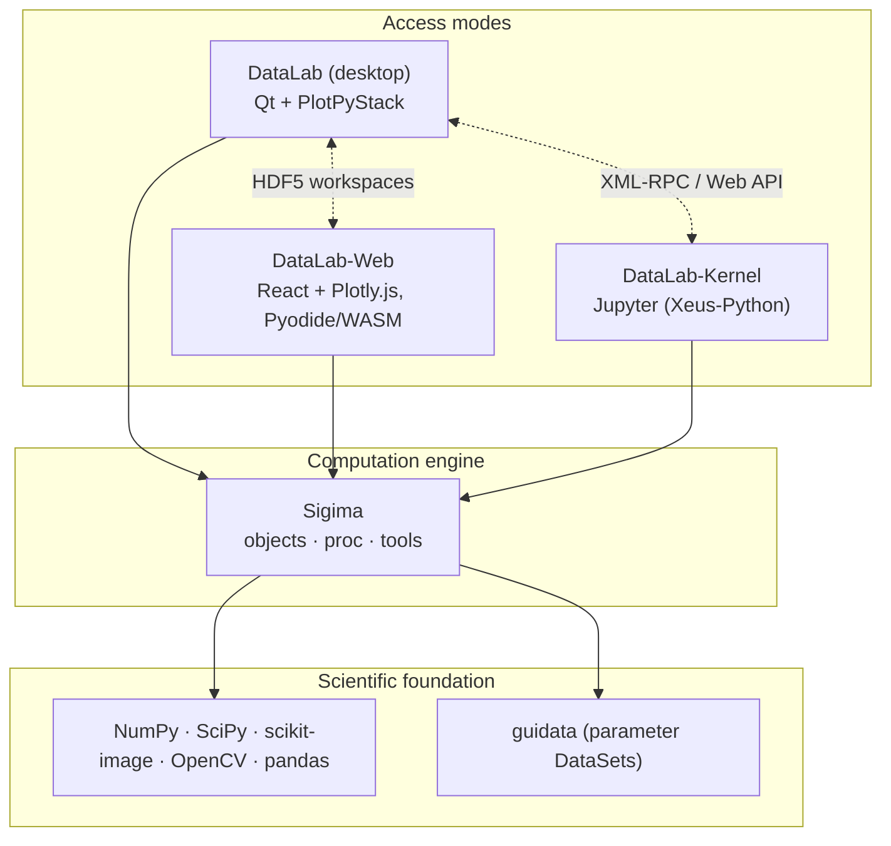

# The DataLab Platform — Complete Overview

> This document is the reference overview of the **DataLab Platform** ecosystem: what each component is, how they fit together, how they differ, and where the platform is heading. For a quick introduction, see the [organization profile](https://github.com/DataLab-Platform).

  

## Table of contents

- [What is the DataLab Platform?](#what-is-the-datalab-platform)
- [Terminology](#terminology)
- [History and milestones](#history-and-milestones)
- [Architecture](#architecture)
- [The products in detail](#the-products-in-detail)
  - [DataLab (desktop)](#datalab-desktop)
  - [Sigima (computation engine)](#sigima-computation-engine)
  - [DataLab-Web (browser-native)](#datalab-web-browser-native)
  - [DataLab-Kernel (Jupyter)](#datalab-kernel-jupyter)
- [Interoperability](#interoperability)
- [DataLab vs DataLab-Web](#datalab-vs-datalab-web)
- [Technology stacks](#technology-stacks)
- [Quality and testing](#quality-and-testing)
- [Governance, licensing and funding](#governance-licensing-and-funding)
- [Roadmap](#roadmap)
- [Resources and links](#resources-and-links)

## What is the DataLab Platform?

The **DataLab Platform** is an open-source ecosystem for scientific and technical data processing, focused on **1D signals** (curves) and **2D images** (arrays). It serves both **research** (exploratory analysis, prototyping) and **industry** (test benches, quality control, non-destructive testing) with the same tools.

What started in 2023 as a single desktop application has grown into a family of complementary products sharing one scientific core:

- a **desktop application** (DataLab) with a rich Qt-based interactive GUI,
- a **browser-native edition** (DataLab-Web) running entirely client-side via WebAssembly — no install, no server, no upload,
- a **Jupyter kernel** (DataLab-Kernel) for notebook-driven workflows,
- a **headless computation engine** (Sigima) powering all of the above.

The guiding principle: **one processing catalog, one object model, one workspace format — several access modes**. Results are identical for the same inputs, whichever edition you use, and HDF5 workspaces flow freely between them.

## Terminology

| Name | Meaning |
| --- | --- |
| **DataLab Platform** | The umbrella term for the whole ecosystem (all products below). |
| **DataLab** | The reference **desktop application** (Qt-based). The historical product. |
| **DataLab-Web** | The **browser-native** edition: the full platform running inside a browser tab. |
| **DataLab-Kernel** | A **Jupyter kernel** exposing DataLab workspaces to notebooks. |
| **Sigima** | The headless **computation engine** (signal and image processing) shared by all of the above. |
| **PlotPyStack** | The Qt visualization foundation used by the desktop application ([guidata](https://github.com/PlotPyStack/guidata), [PythonQwt](https://github.com/PlotPyStack/PythonQwt), [PlotPy](https://github.com/PlotPyStack/PlotPy)) — a sibling organization maintained by the same team. |

## History and milestones

| Date | Milestone |
| --- | --- |
| 2023 | DataLab launched as an open-source desktop application for signal/image processing, built on the PlotPyStack (guidata + PlotPy). |
| 2024 | Talks at [SciPy 2024](https://www.youtube.com/watch?v=MKPUuV1LEqk) and [PyData Paris 2024](https://www.youtube.com/watch?v=yn1bR-BVfn8). |
| 2025 | **DCAR project** (DataLab Core Architecture Redesign, funded by [NLnet](https://nlnet.nl/) / NGI0 Commons Fund): extraction of all processing logic into the standalone, GUI-independent **Sigima** library. |
| 2025-10-28 | **Sigima v1.0.0** released on PyPI. |
| 2025-11 | **DataLab v1.0.0** released — complete rewrite using Sigima as its processing backend. DCAR completed. |
| 2026 | **DEW project** (DataLab Experimental Web Interface, funded by NLnet / NGI0 Commons Fund): browser-native reimplementation. |
| 2026-06-26 | DEW Task 1 (feature-rich browser-native DataLab) fully delivered — [live demo](https://datalab-platform.com/web/) with off-thread runtime, on-disk storage, internationalization (EN/FR). |

Full project reports and Architecture Decision Records are published on the [DataLab wiki](https://github.com/DataLab-Platform/DataLab/wiki).

## Architecture

The platform follows a strict layered design: the science lives in one place (Sigima), and each product is an access mode on top of it.

Key architectural facts:

- **Sigima is GUI-independent** (no Qt), organized in three layers: `sigima.objects` (data model: `SignalObj`, `ImageObj`, ROIs), `sigima.proc` (high-level computation functions on objects), `sigima.tools` (low-level NumPy algorithms).
- **Processing parameters are declarative** `guidata` DataSets: every edition auto-generates its parameter dialogs from the same schemas (Qt widgets on desktop, React forms on the web).
- **The processing catalog is discovered by introspection**: a function registered in Sigima with `@computation_function` automatically appears in the desktop menus, the web menus, and the kernel API — no per-edition wiring.
- **Interoperability is contract-based**: the HDF5 workspace format, the object model, and the remote-control API surfaces are shared contracts between editions.

## The products in detail

### DataLab (desktop)

The reference application — richest feature set and fastest experience.

- **Repository**: [DataLab-Platform/DataLab](https://github.com/DataLab-Platform/DataLab) · **PyPI**: [`datalab-platform`](https://pypi.org/project/datalab-platform/) · **Docs**: [datalab-platform.com](https://datalab-platform.com/)
- **GUI**: Qt via the PlotPyStack — full interactive PlotPy visualization tools (zoom, cross-sections, contrast adjustment, annotations, ROI editing).
- **Processor pattern**: a registration layer maps Sigima functions to generic processing types (1→1, 1→0, 1→n, n→1, 2→1) with multi-selection semantics, X-array compatibility checks and auto-interpolation.
- **Plugin system**: extensible architecture with hot-reload; plugins get access to panels, a local proxy and dialog helpers.
- **Macro system**: user-scriptable automation in Python through the proxy API.
- **Remote control**: XML-RPC API (`RemoteProxy`) plus a FastAPI-based **Web API** (HTTP/JSON, token-authenticated) used notably by DataLab-Kernel.
- **Persistence**: HDF5 workspaces on disk; broad file-format support for signals and images (CSV, TIFF, DICOM, FITS, and more via plugins).
- **Deployment**: pip, conda, standalone Windows installer (PyInstaller/WiX); runs on Windows, Linux, macOS.
- **Languages**: English and French (UI and documentation).

### Sigima (computation engine)

The open-source scientific core powering every edition.

- **Repository**: [DataLab-Platform/Sigima](https://github.com/DataLab-Platform/Sigima) · **PyPI**: [`sigima`](https://pypi.org/project/Sigima/) · **Docs**: [sigima.readthedocs.io](https://sigima.readthedocs.io/)
- **Headless by design**: no Qt dependency; runs on CPython and on Pyodide (WebAssembly) unchanged.
- **Three-layer model**:
  - `sigima.objects` — data model (`SignalObj`, `ImageObj` wrapping NumPy arrays, ROI types, scalar results),
  - `sigima.proc` — high-level computation functions operating on objects (filtering, FFT, fitting, morphology, detection, stability analysis, …),
  - `sigima.tools` — low-level NumPy/SciPy algorithms usable independently of the object model.
- **Dual calling conventions**: every `proc` function accepts either a parameter DataSet or plain keyword arguments — GUI-friendly and script-friendly at once.
- **ROI system**: segment ROIs for signals; rectangular, circular and polygonal ROIs for images, with automatic masking and clipping.
- **I/O**: signal/image readers and writers shared across the platform.
- **Validation-oriented testing**: pytest suite with a strict validation mode and optional GUI-assisted visual checks.

### DataLab-Web (browser-native)

The full platform in a browser tab — zero install, zero server, zero upload.

- **Repository**: [DataLab-Platform/web](https://github.com/DataLab-Platform/web) · **Live demo**: [datalab-platform.com/web](https://datalab-platform.com/web/)
- **Runtime**: [Pyodide](https://pyodide.org/) (CPython compiled to WebAssembly) executes Sigima **locally in the browser** — data never leaves the user's machine. Static hosting is enough (the demo runs on GitHub Pages).
- **UI**: custom React + TypeScript interface modelled on the desktop application, with Plotly.js visualization (canvas-rasterized image rendering for large arrays).
- **Off-thread execution**: the whole Python runtime lives in a dedicated Web Worker behind a typed façade, with zero-copy transfers — the UI never freezes during computation.
- **On-disk storage**: an optional OPFS (Origin Private File System) engine spills heavy arrays to disk, lifting the ~2 GB WebAssembly memory ceiling — the working set becomes bounded by disk quota, not RAM.
- **Interruptible batch processing**: multi-object operations can be cancelled at object boundaries.
- **Feature parity highlights**: signals, images, ROIs, the full Sigima processing catalog, interactive fits, HDF5 workspace import/export, plugins, macros, notebooks, command palette, guided tours, AI assistant panel, 70+ scientific colormaps.
- **SDK**: a TypeScript host SDK (`@datalab-platform/web-sdk`) allows embedding and remote-controlling DataLab-Web via `postMessage`.
- **Languages**: English and French, with automatic browser-language detection.

### DataLab-Kernel (Jupyter)

A custom Jupyter kernel bridging DataLab and the notebook ecosystem.

- **Repository**: [DataLab-Platform/DataLab-Kernel](https://github.com/DataLab-Platform/DataLab-Kernel) · **PyPI**: [`datalab-kernel`](https://pypi.org/project/datalab-kernel/) · **Docs**: [datalab-kernel.readthedocs.io](https://datalab-kernel.readthedocs.io/)
- **Built on [Xeus-Python](https://github.com/jupyter-xeus/xeus-python)**: runs in JupyterLab, Jupyter Notebook, VS Code — and in **JupyterLite** (browser-based, no server).
- **Single stable user API**: `workspace` (data access and persistence), `plotter` (Plotly interactive or Matplotlib static), `sigima` (processing).
- **Two execution modes, one notebook**:
  - **Live mode** — auto-discovers a running DataLab desktop instance (via its Web API) and keeps workspace and views synchronized with the GUI,
  - **Standalone mode** — notebook-only execution, fully reproducible, no DataLab required.
- **Reproducibility by design**: analyses persist as `.h5` files; notebooks run unchanged across environments.
- **Try it online**: live notebooks via [notebook.link](https://notebook.link/github/DataLab-Platform/DataLab-Kernel/tree/main/notebooks/?path=/notebooks/datalab_kernel_quickstart.ipynb) (JupyterLite, zero setup).

## Interoperability

The editions are not competitors — they are interchangeable access modes:

- **HDF5 workspaces** are the common persistence format: a workspace saved on desktop opens in DataLab-Web, in a notebook, and vice versa.
- **The processing catalog** is discovered from Sigima in every edition: same functions, same parameters, same results.
- **Parameter dialogs** are auto-generated from the same guidata DataSet schemas everywhere.
- **Plugins** are largely portable between desktop and web, with a few constraints related to the browser runtime.
- **Remote control** surfaces: XML-RPC and Web API on desktop; in-browser proxy and `postMessage` SDK on the web; live synchronization from notebooks via DataLab-Kernel.

A common pattern: desktop application on your personal workstation, DataLab-Web everywhere else, notebooks for reproducible reporting — all sharing the same `.h5` files.

## DataLab vs DataLab-Web

The differences are about the **runtime environment**, not about the science.

| Topic | DataLab (desktop) | DataLab-Web |
| --- | --- | --- |
| Installation | Installed locally (Windows, Linux, macOS) | None — runs in the browser |
| Python runtime | System CPython | Pyodide (CPython on WebAssembly) |
| Graphical interface | Qt + PlotPy | React + Plotly.js |
| Plotting | PlotPy (Qt), full interactive tools | Plotly.js (interactive tools partially reimplemented) |
| File access | Native file system I/O | Browser file picker, drag-and-drop |
| Persistence | HDF5 on disk | HDF5 download / upload (interoperable) |
| Memory | Limited by system RAM (64-bit) | ~2 GB WASM heap by default; optional on-disk storage mode lifts the limit (bounded by disk quota) |
| Remote control | XML-RPC and FastAPI Web API | In-browser proxy and optional `postMessage` SDK |
| Privacy | Local | Local too — no server, no account, no upload |

What is **not** different: the object model (`SignalObj`, `ImageObj`, ROIs, groups), the processing catalog, the auto-generated parameter dialogs, and the HDF5 workspace format.

## Technology stacks

| Product | Version | Core stack |
| --- | --- | --- |
| DataLab (desktop) | 1.x | Python 3.9+, Qt (PlotPy ≥ 2.8, guidata ≥ 3.13), NumPy, SciPy, scikit-image, OpenCV, FastAPI (Web API) |
| Sigima | 1.x | Python 3.9+, NumPy, SciPy, scikit-image, pandas, guidata (parameters only) — no GUI dependency |
| DataLab-Web | 0.x | TypeScript, React, Plotly.js, Vite, Pyodide (pinned), Vitest, Playwright |
| DataLab-Kernel | 0.x | Xeus-Python, Plotly / Matplotlib backends, DataLab Web API client |
| PlotPyStack (foundation) | — | guidata, PythonQwt, PlotPy (Qt via QtPy: PyQt5/PyQt6/PySide6) |

## Quality and testing

- **Sigima**: headless pytest suite with a strict validation mode (numerically validated results), plus optional GUI-assisted visual checks; independent CI/CD.
- **DataLab**: pytest suite covering GUI features and processing integration; Ruff linting; gettext-based i18n with French translations for UI and Sphinx documentation.
- **DataLab-Web**: three-layer test pyramid — pytest running *inside* Pyodide (Python core), Vitest + React Testing Library (unit/component), Playwright (end-to-end in Chromium, worker mode); i18n catalog checks in CI; a shim registry with anti-drift tests tracks temporary backports of upstream fixes.
- **DataLab-Kernel**: tested in both live (DataLab-attached) and standalone modes.

## Governance, licensing and funding

- **License**: BSD 3-Clause across the platform (DataLab, Sigima, DataLab-Web, DataLab-Kernel).
- **Copyright**: DataLab Platform Developers.
- **Funding**: two projects funded by the [NLnet Foundation](https://nlnet.nl/) through the NGI0 Commons Fund:
  - **DCAR** (DataLab Core Architecture Redesign) — completed December 2025 with Sigima v1.0.0 and DataLab v1.0.0,
  - **DEW** (DataLab Experimental Web Interface) — in progress; Task 1 (browser-native application) delivered June 2026.
- **GenAI policy**: development follows the [NLnet policy on generative AI](https://nlnet.nl/foundation/policies/generativeAI/) — AI is a development aid only; review, architecture and scientific validation remain under human responsibility, and AI-assisted commits are labelled.
- **Industrial backing**: DataLab was born from industrial needs (test benches, metrology) and is maintained with the support of [CODRA](https://codra.net/).

## Roadmap

Publicly announced directions (see the [wiki reports](https://github.com/DataLab-Platform/DataLab/wiki) for details):

- **Snapshot Sync Server** (DEW Task 2): a lightweight FastAPI registry of immutable workspace snapshots for asynchronous collaboration around DataLab-Web.
- **Accessibility and security** (DEW Task 3): WCAG-driven accessibility improvements and a security hardening pass on DataLab-Web.
- **wasm64**: transitioning DataLab-Web to 64-bit WebAssembly once stable, natively lifting the memory ceiling.
- Continuous growth of the **Sigima processing catalog**, automatically surfacing in every edition.

## Resources and links

| Resource | URL |
| --- | --- |
| Website (and desktop docs) | <https://datalab-platform.com/> |
| DataLab-Web live demo | <https://datalab-platform.com/web/> |
| Sigima documentation | <https://sigima.readthedocs.io/> |
| DataLab-Kernel documentation | <https://datalab-kernel.readthedocs.io/> |
| Project reports & ADRs (wiki) | <https://github.com/DataLab-Platform/DataLab/wiki> |
| SciPy 2024 talk (video) | <https://www.youtube.com/watch?v=MKPUuV1LEqk> |
| PyData Paris 2024 talk (video) | <https://www.youtube.com/watch?v=yn1bR-BVfn8> |
| PlotPyStack organization | <https://github.com/PlotPyStack> |
